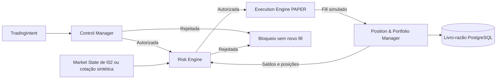

# Visão de arquitetura do Trading Core PAPER

**I03 · DRAFT · 12/11/2026**  
Referência arquitetural: `TS-ARCH-GLOBAL-V1.0`. Recorte: TS-EP-05 e TS-EP-06, histórias TS-ST-009–012.

O Trading Core PAPER processa intenções BTCUSDT, aplica controles e limites de risco, simula fills e mantém saldos e posições reconciliáveis. O Spot é o recorte exercitado pelos testes unitários do checkout. As evidências históricas de I03 incluem persistência Spot, Market State, custos e Futures sintético. O fluxo opera em PAPER, com capital e execução simulados. LIVE permanece indisponível.

## Fronteiras e fluxo

O diagrama mostra responsabilidades lógicas. No caminho de Market State documentado no ensaio, Control autoriza antes de solicitar a cotação, que é então avaliada por Risk. Execution e Portfolio compartilham a transação do livro-razão no recorte persistido descrito. O fluxo obrigatório de autoridade vem de ADR-017/018 e F03. F04/F05 têm projeção local em PAPER, com fills simulados e reconciliação interna.

| Componente | Responsabilidade no recorte I03 | História |
|---|---|---|
| D03-C04 · Control Manager | Verifica ambiente PAPER, conta, ator, pausa e validade da intenção. O desenho de modos, aprovações e emergency lock é parte do contrato de Control. | TS-ST-009 |
| D03-C01 · Risk Engine | Avalia quantidade, cotação, limites de exposição e recursos disponíveis. As evidências de custos e Futures acrescentam verificações de custo total e colateral. | TS-ST-010 |
| D03-C02 · Execution Engine | Aplica o resultado autorizado em um fill simulado. Preserva identificação, correlação e referência da cotação. | TS-ST-011 |
| D03-C03 · Position & Portfolio Manager | Mantém caixa e posição e recompõe os saldos a partir dos fills. O ensaio Futures também registra margem e PnL realizado. | TS-ST-012 |
| D05-C01 · Operational Database | Persiste o estado transacional da conta e os fills no livro-razão. | Suporte a TS-ST-011/012 |

Os nomes `ControlDecision`, `RiskDecision`, `FillEvent`, `PortfolioSnapshot` e `ReconciliationStatus` vêm da visão de interfaces do Blueprint. Os testes locais exercitam tipos como `TradingIntent`, `ControlPolicy`, `RiskLimits` e `PaperFill`. A formalização dos contratos versionados de I03, a emissão de eventos e a trilha ponta a ponta de F09 dependem de P31 e dos contratos de D05. Consulte a [matriz de I03](../governance/DOC-03-I03-TRACEABILITY.md).

## Dados e garantias

- **Cotação e tempo.** O ensaio Spot com Market State usa o fechamento de 5m disponível na emissão da intenção. Risk volta a verificar a idade da cotação no instante da execução. O fill registra o snapshot, a linhagem e seu SHA-256. Preços e quantidades usam decimais, e timestamps são tratados em UTC. [Evidência de Market State em PAPER](../evidence/I03-market-state-paper.md)
- **Atomicidade e replay.** No livro-razão persistido, a chave é conta e ID da intenção. Uma repetição idêntica dentro da validade retorna o fill existente. Conteúdo conflitante para a mesma chave é rejeitado. A falha induzida após inserir o fill reverteu a transação e preservou o saldo. [Evidência do livro-razão](../evidence/I03-persistencia-paper.md)
- **Reconciliação.** A recomposição parte do saldo de abertura e compara o resultado com o estado persistido. Os ensaios detectaram divergências induzidas no fill e na evidência de cotação. Custos Spot e margem isolada a 1× em Futures são recortes experimentais com parâmetros sintéticos. [Custos Spot](../evidence/I03-custos-paper.md) · [Futures PAPER](../evidence/I03-futures-paper.md)
- **Bloqueio e recuperação.** Rejeições devem impedir um novo fill e preservar o saldo. Os testes atuais exercitam pausa, autoridade, expiração e limites. A arquitetura de emergência e retomada segue F06/F10 e ainda requer estados, responsáveis, critérios de liberação e evidência de teste. [Testes Spot](../../tests/unit/test_paper_simulator.py)

## Decisões que precisam de validação

A [especificação de Control e Risk](../domains/d03-control-risk-paper.md) detalha as regras, os contratos conceituais e os testes esperados para TS-ST-009 e TS-ST-010.

A [especificação de execução simulada e reconciliação do Portfolio](../domains/d03-execution-portfolio-paper.md) detalha TS-ST-011 e TS-ST-012, o replay, a atomicidade e os critérios de reconciliação.

| Tema | Decisão ou fonte necessária | Rastreabilidade |
|---|---|---|
| Autoridade e emergência | Aprovar transições entre AUTO, SUPERVISED, MANUAL e PAUSED, confirmação humana, escopo do emergency lock e condições de retomada. Definir os controles protetivos mínimos durante indisponibilidade. | TS-ST-009 · ADR-024–027 · P26–P28, P30 · F06/F10 |
| Política de risco | Aprovar limites por mercado, cálculo de tamanho e exposição, resposta ADJUSTED, validade de cotação e versão da política por decisão. | TS-ST-010 · ADR-019/020 · P19/P20 |
| Execução e recuperação | Aprovar tipos e filtros aplicáveis ao simulador, máquina de estados, política de idempotência para reenvios fora da janela exercitada e cenários de timeout e estados incertos. Definir o que comprova paridade lógica. | TS-ST-011 · ADR-021/027/080 · P21/P22/P29/P96 |
| Portfolio e custos | Validar regras de equity, PnL, taxas, funding, margem, liquidação e cadência da reconciliação. Os parâmetros observados têm escopo de teste. | TS-ST-012 · ADR-022/023 · P23–P25/P99 |
| Auditoria e falhas | Aprovar schemas, versões, IDs e publicação de eventos de Control, Risk, Execution e Portfolio. Identificar as evidências de rollback, duplicidade e recuperação necessárias ao aceite. | ADR-028/052/081 · P31/P32/P99 · F09/F10 |
| Candidato I03 | Recuperar o commit ou snapshot das migrations 0008–0011, as suítes correspondentes e os resultados vinculados. Identificar a decisão humana de aceite de I03, caso exista. | DOC-03 · [Matriz de I03](../governance/DOC-03-I03-TRACEABILITY.md) |

As fases primárias permanecem conforme a baseline. A antecipação de partes críticas de P29–P32 para PAPER segue G40. G0 permanece aberto.

## Fontes e limite da evidência

- **Arquitetura aprovada.** O Blueprint define F03–F06, F09–F10, D03-C01–C04 e TS-ST-009–012. D03 registra as decisões de autoridade, risco, execução, posições e recuperação. [Blueprint](<../referencias/originais/TS-ARCH-GLOBAL-V1.0 - Architecture & MVP Blueprint.txt>) · [D03 original](<../referencias/originais/Domínio 03 - Risco, Execução e Controle Operacional.txt>)
- **Requisitos de origem.** No acervo `01. ESPECIFICAÇÃO/Descritivo da Solução.txt`, as seções de arquitetura e fluxo operacional fundamentam a necessidade de avaliação de risco, execução e gestão de posição. Em `02. ARQUITETURA/00. Trading Operating System.txt`, a seção 7 reforça a independência de Risk. `00. MATERIAL DE APOIO/Rascunho.txt` lista referências exploratórias. O escopo PAPER, seus critérios e decisões vêm das baselines e da matriz de I03.
- **Evidência de implementação.** A matriz registra 14 testes unitários aprovados para Spot em memória e os ensaios históricos em PostgreSQL. No checkout oficial, `apps/market_data/paper.py` chama `PaperLedger.submit_with_quote_provider`, que está presente no livro-razão Spot. O caminho integrado descrito em 11/11 precisa ser confirmado no candidato correspondente. [Entrada PAPER](../../apps/market_data/paper.py) · [Livro-razão no checkout](../../infrastructure/database/paper_ledger.py) · [Matriz de I03](../governance/DOC-03-I03-TRACEABILITY.md)
