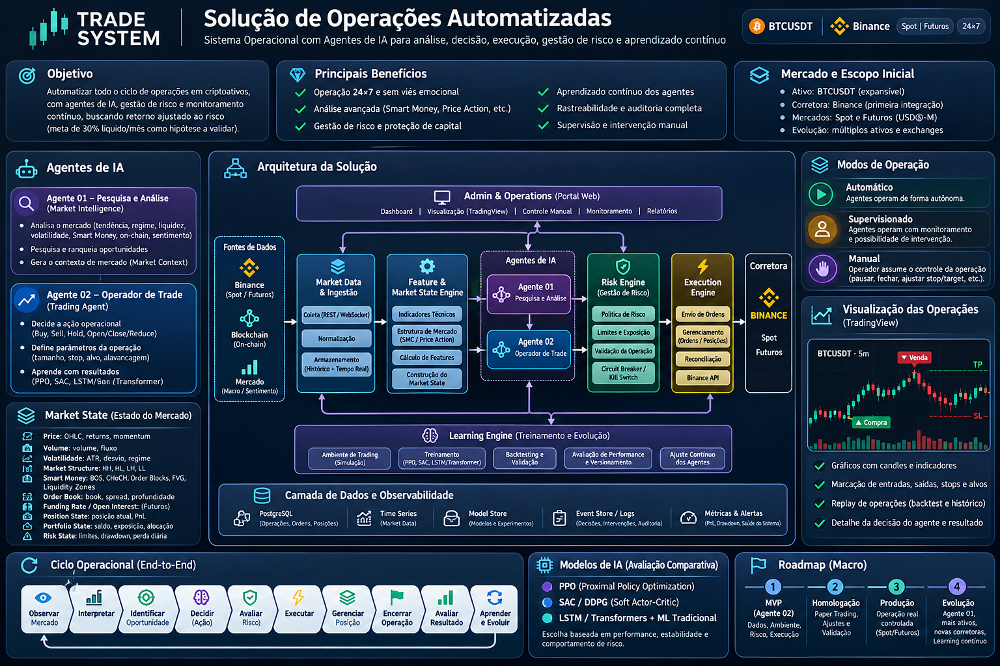

# Visão inicial do Trade System

O Trade System V1 pretende observar o mercado, produzir intenções de negociação, avaliar autorização e risco, registrar resultados e usar essas evidências para avaliar novas versões dos modelos. A imagem apresenta a solução completa. O trabalho atual é o I00, a fundação técnica sobre a qual os módulos serão construídos.

## Como a imagem se conecta à arquitetura

| Bloco da imagem | Domínio e leitura para a implementação |
|---|---|
| Fontes, ingestão, features e Market State | **D01** normaliza dados, calcula features e entrega uma visão versionada do mercado. I01 e I02 cobrem essas fundações. On-chain, macro e sentimento aparecem na visão geral e dependem de escopo próprio. |
| Agentes 01 e 02, Learning Engine | **D02** separa pesquisa, decisão e aprendizado. O agente de negociação emite uma intenção. PPO faz parte do roadmap em I04. A imagem apresenta outras famílias de modelos para comparação futura. |
| Risk Engine, Execution Engine e corretora | **D03** exige o caminho `TradingIntent → Control → Risk → Execution`. Control verifica autoridade, modo e permissões. Risk aplica limites. Execution recebe ações autorizadas e o estado precisa ser reconciliado. |
| Portal, modos de operação e TradingView | **D04** prevê supervisão e intervenção por APIs autorizadas. O controle manual também passa por Control e Risk. Automático, supervisionado e manual descrevem modos de operação. TRAINING, PAPER e LIVE são ambientes segregados. |
| Dados, eventos, métricas e auditoria | **D05** prevê PostgreSQL como fonte transacional, Outbox na mesma transação e consumidores idempotentes. O bloco de logs e eventos da imagem é compatível com isso. Event sourcing integral é opcional segundo a baseline. |
| Operação contínua, segurança e recuperação | **D06** trata de isolamento, segredos, disponibilidade e recuperação. O I00 usa apenas infraestrutura local de desenvolvimento e testes. |
| Backtesting, evidências e evolução | **D07** exige evidência reproduzível e decisão humana nos gates G0–G5. A meta de 30% líquidos ao mês aparece como hipótese de negócio, sem critério de aprovação associado. |

## Como interpretar as fontes

| Fonte | O que confirma |
|---|---|
| `00. MATERIAL DE APOIO` | A imagem e o descritivo registram a visão original. O descritivo apresenta 30% líquidos ao mês como objetivo inicial. A imagem e os documentos D02/D07 registram a meta como hipótese a validar. |
| `02. ARQUITETURA` | O Blueprint inclui o encerramento das seis etapas e o registro de aprovação G01–G60. O Engineering Foundation inclui a aprovação final de T01–T10 e das ADRs TS-ADR-089–098. As capas refletem a etapa inicial de validação. Os Word D01–D07 são fontes para recuperar as decisões e pendências. As avaliações de Binance e TradingView dão contexto às integrações futuras. |
| Starter de engenharia | [Escopo](../00-BASELINE-E-ESCOPO.md), [arquitetura física](../01-ARQUITETURA-FISICA.md), [backlog](../02-I00-BACKLOG.md), [contratos](../03-CONTRATOS.md), [aceite](../04-SEGURANCA-E-ACEITE.md), [ADRs](../05-ADRS-TECNICAS.md) e [rastreabilidade](../06-PENDENCIAS-E-RASTREABILIDADE.md) orientam o trabalho diário. Os DOCX em `docs/referencias/` são reconstruções. |

## Próximas decisões de engenharia

1. Revisar o bootstrap I00-01, I00-02 e I00-11 no VS Code e conferir as [evidências locais](../evidence/I00-bootstrap.md) e a execução do Actions no GitHub.
2. Após aprovação, começar I00-03 e validar os contratos de comando e evento com dados sintéticos. I00-04 trata do PostgreSQL e das migrations. I00-05 depende dos dois e implementa a Outbox.
3. Para reconciliar P01–P47, registrar por ID a descrição original, o documento e a seção, a versão consolidada e eventuais divergências. O D02 descreve P18 como detecção de degradação e gatilhos de retreinamento. O D04 registra P47 em testes E2E, acessibilidade, segurança e falhas de interface. A classificação de P18 segue provisória.

O escopo atual termina na fundação técnica. LIVE permanece indisponível e os gates operacionais exigem evidências e decisão humana.
